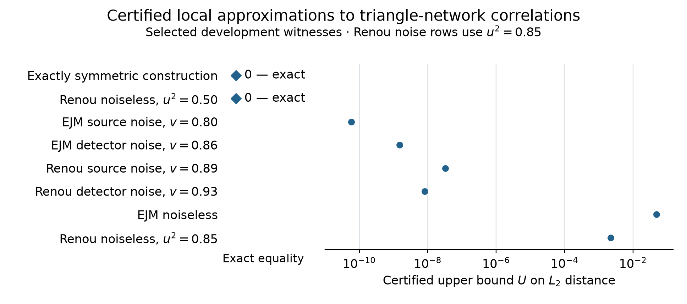
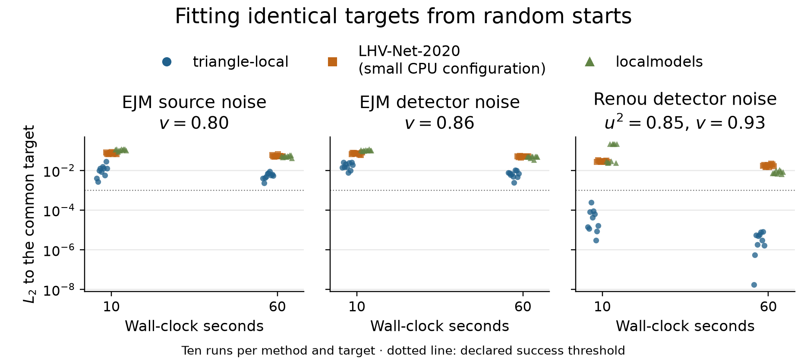
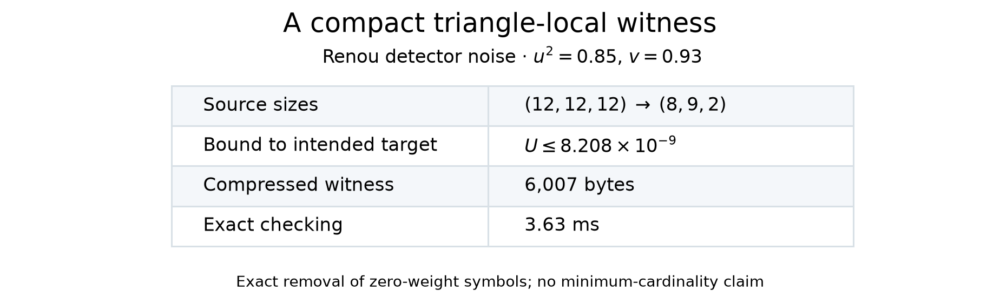

# triangle-local

**Portable finite triangle-local witnesses, exactly checked, with rigorous error bounds to the intended target.** Triangle-local is a certification and interoperability layer for numerical local-model constructions. It exports independent source laws and stochastic response tables, checks their full rational contraction exactly, and accounts for the difference between the stored target and the intended distribution. A recipient can check the witness without rerunning or trusting its search.

**Authors:** Haobo Ma and Wenlin Zhang. **License:** [MIT](LICENSE).

## An exactly symmetric construction

The explicit independent-source witness has **P(A=B=C)=41/144 > 1/4**. Its 64 output probabilities depend only on the equality pattern: 123/1728 for each all-equal cell, 19/1728 for each exactly-two-equal cell, and 23/1728 for each all-distinct cell. This proves full party symmetry and simultaneous outcome-relabeling symmetry exactly. It directly addresses the exact-symmetry question posed by **Bäumer, Gitton, Kriváchy, Gisin and Renner**, whose discussion includes approximately symmetric neural examples near 0.29. The scientific point is exact symmetry, not a comparison of approximate numbers or a claim of priority over every later work.

The [note](note.pdf) gives the complete construction and the [exact witness bundle](benchmarks/models/000-note-41-144-explicit.json.gz). The [supporting source note](research/witness-note-round1.tex) links the revision-pinned Lean source; the local certificate and integer enumeration can be checked independently without Lean.



## What is certified

For an exactly local rational model Q and stored rational target P_stored, the checker computes **E = ||P_stored−Q||₂² exactly**. A separate validated interval calculation gives δ ≥ ||P−P_stored||₂. The scientific bound is **U ≥ sqrt(E)+δ**, rounded upward, so `d_triangle(P) ≤ ||P−Q||₂ ≤ U`.

The headline uses U, with exact zeros explicitly marked and noiseless endpoints counted once. Selected development witnesses include EJM source v=0.80 with **U ≤ 5.774e-11**, EJM detector v=0.86 with **U ≤ 1.510e-9**, and Renou detector u²=0.85, v=0.93 with **U ≤ 8.208e-9**. These witnesses may use seeded development searches and are separate from the cold-start comparison.

Renou source noise uses `ρ_v = v|φ⁺⟩⟨φ⁺| + (1−v)I₄/4` on each independent edge, where `|φ⁺⟩ = (|00⟩+|11⟩)/√2`; the network state is `ρ_v ⊗ ρ_v ⊗ ρ_v`. Detector noise instead applies the independent output channel `K_v ⊗ K_v ⊗ K_v`, with `K_v = vI + (1−v)J/4`.

A positive U certifies a nearby local distribution; it does not prove exact locality of the intended target. Exact stored-target equality proves intended-target locality only when target identity is also exact. A positive residual does not establish nonlocality or optimality. The checker is tested integer-arithmetic software, not a formally verified implementation. [RESULTS.md](RESULTS.md) separates stored-target residuals, interval enclosures, and U for every featured result.

## A matched three-way comparison

The current experiment uses one hashed 64-entry target array per test, **ten independent cold starts for each of three methods on three targets**, and completed budgets of **10 and 60 seconds**. Triangle-local and localmodels use full finite contractions; LHV-Net-2020 (small CPU configuration, eager TensorFlow wrapper) checkpoints receive over one million fresh held-out samples each, with uncertainty reported after checkpoint selection. The neural score is the raw norm `||Q̂−T||₂`, without variance correction or truncation; approximate 95% basic block-bootstrap intervals use 2,000 resamples and clip both endpoints at zero. The separate variance-corrected diagnostic and the exact interval formula are documented in [BENCHMARK.md](BENCHMARK.md#metric-and-checkpoint-evaluation). Every score is recomputed from a saved output in the same L2 metric; localmodels' internal RMSE satisfies **L2 = 8 RMSE**. Runs are serial, CPU-only, with one numerical-library thread.



See [the comparison table and assessment](RESULTS.md), [the full protocol](BENCHMARK.md), and [raw outcomes](benchmarks/round4/outcomes.csv). The neural arm is a declared small CPU configuration of the public 2020 architecture. This experiment is not an unrestricted solver ranking or a comparison with the 2026 adaptive neural toolbox.

Finite-model search is established by da Silva and Parisio, and both LHV-Net and localmodels already describe local models. The contribution here is rational export, rigorous target-error accounting, compact witnesses, and an independent checking path. The saved-network extraction example demonstrates interoperability and includes equal-time random finite-model polishing controls. [LITERATURE.md](LITERATURE.md) gives the related work and attribution.

## Quick start

Run these five lines from the repository root with Python 3.10 or later. They
install the package, solve the Renou half endpoint, and verify its certificate
against the generated input:

```sh
python3 -m venv .venv && .venv/bin/python -m pip install -e './tool[test,plot,bounds]'
export OMP_NUM_THREADS=1 OPENBLAS_NUM_THREADS=1 VECLIB_MAXIMUM_THREADS=1
.venv/bin/python -m triangle_local generate renou --parameter 1/2 --out tmp/renou-half.json
.venv/bin/python -m triangle_local solve tmp/renou-half.json --sizes 4 4 4 --starts 1 --steps 20 --out tmp/renou-half-fit.json.gz
.venv/bin/python -m triangle_local verify tmp/renou-half-fit.json.gz --input tmp/renou-half.json
```

The verifier prints `"status": "exact_match"`, `"exact_match": true`,
`"L1": "0"`, and `"L2_squared": "0"`. This endpoint uses the default hybrid
method's known-control recognizer; it demonstrates an exact construction.
The [command-line example below](#command-line) performs a numerical EJM fit.
For an approximate fit, successful verification means the model and its
distance were recomputed correctly; inspect `exact_match` for target equality.

A portable bundle can also be checked with the standalone standard-library auditor:

```sh
python3 benchmarks/independent_check.py \
  --bundle benchmarks/models/renou-detector-93-100-trimmed-8-9-2.json.gz
```

This recomputes exact locality and stored-target errors without importing the package or using the optimizer. Intended-target interval enclosures are a separate check.

## Inspect a compact witness



The [Renou detector witness at u²=0.85, v=0.93](benchmarks/models/renou-detector-93-100-trimmed-8-9-2.json.gz) has active supports **(8,9,2)** after exact removal of zero-weight symbols from a (12,12,12) model. The contraction is unchanged, stochastic responses are preserved, and the original-target bound is **U ≤ 8.208e-9**. This is exact trimming, not a minimum-cardinality claim. The box reports the measured scope of checking; [the receipt](benchmarks/round4/compact-verification.json) gives its timing boundary.

Regenerate the three figure pairs from checked records, without optimization:

```sh
OMP_NUM_THREADS=1 OPENBLAS_NUM_THREADS=1 VECLIB_MAXIMUM_THREADS=1 \
  .venv/bin/python docs/make_figures.py
```

[Figure captions](docs/figures/README.md) explain the original-target bounds, explicit exact zeros, and individual cold-start outcomes. Earlier unequal-budget configuration experiments remain a small descriptive table in [RESULTS.md](RESULTS.md), with additional and total runtimes separated.

## Install and test

Use Python 3.10 or later from the repository root:

```sh
python3 -m venv .venv
.venv/bin/python -m pip install -e './tool[test,plot,bounds]'
OMP_NUM_THREADS=1 OPENBLAS_NUM_THREADS=1 VECLIB_MAXIMUM_THREADS=1 \
  .venv/bin/python -m pytest tool -q
```

The `plot` extra is optional. Runtime dependencies are NumPy and SciPy; `test`
adds pytest and `plot` adds Matplotlib. `uv pip install --python
.venv/bin/python -e './tool[test,plot,bounds]'` is an alternative installer.
The software and original documentation are licensed under [MIT](LICENSE).
Third-party full texts and the authors' target-generator source retain their
own licenses and are excluded from the public archive. Bibliographic receipts
and source hashes identify the cited originals.

## Command line

The installed command is `triangle-local`; `python -m triangle_local` is
identical. For a published EJM source target at visibility 0.80:

```sh
.venv/bin/python -m triangle_local generate elegant-source \
  --parameter 4/5 --out examples/elegant-source-v08.json
OMP_NUM_THREADS=1 OPENBLAS_NUM_THREADS=1 VECLIB_MAXIMUM_THREADS=1 \
  .venv/bin/python -m triangle_local solve examples/elegant-source-v08.json \
  --sizes 12 12 12 --method hybrid --seed-model note --jitter 0.15 \
  --starts 1 --steps 1800 --hops 2 --polish-steps 200 --inner-steps 150 \
  --seed 20261010 --max-denominator 1000000000 \
  --out examples/elegant-fit.json.gz
.venv/bin/python -m triangle_local verify examples/elegant-fit.json.gz \
  --input examples/elegant-source-v08.json
```

JSON and gzip-compressed JSON bundles have the same schema. Verification checks
an approximate-fit certificate successfully when its model and distances are
correct; inspect `exact_match` to determine whether it certifies the target.

For a general distribution, pass its JSON or CSV file to `solve`, choose the
three source alphabet sizes, and use `--symmetry none`. The default `hybrid`
method combines joint L-BFGS-B, convex polishing, and two perturbation searches.
`--initial` accepts a saved bundle or model, automatically splitting symbols
independently when the requested alphabets are larger. `--seed-model` selects
`note`, `ring-half`, `ring-endpoint`, `parity`, or the CHSH-boundary `fritz`
construction. `--jitter` perturbs responses after lifting. The numerical hybrid
recognizer also checks known controls and product distributions before blind
optimization; recognition itself never determines the certificate status.

An exact Renou endpoint can be recovered with the default hybrid recognizer:

```sh
.venv/bin/python -m triangle_local generate renou --parameter 1/2 \
  --out examples/renou-half.json
.venv/bin/python -m triangle_local solve examples/renou-half.json \
  --sizes 12 12 12 --out examples/renou-half-fit.json
.venv/bin/python -m triangle_local verify examples/renou-half-fit.json \
  --input examples/renou-half.json
```

The old blind endpoint failure is retained in the component comparison. The
recognized or explicitly seeded result is labeled separately.

## Input format

JSON accepts a nested three-dimensional tensor or this row-major representation
with `c` varying fastest. Rational strings preserve the intended input exactly:

```json
{
  "outputs": [2, 2, 2],
  "probabilities": ["1/4", "0", "0", "1/4", "0", "1/4", "1/4", "0"]
}
```

JSON decimals mean their exact decimal values. Inputs must be nonnegative and
sum exactly to one. `--normalize-input` explicitly divides every entry by the
exact total; the bundle records this choice, and `verify --input` repeats it.

CSV uses the exact header `a,b,c,p` and zero-based integer labels. Zero cells may
be omitted. Duplicate or negative indices are rejected. Alphabet sizes are
inferred; use `--outputs A B C` on `solve` when unused trailing labels must be
preserved. External verification uses the certified output sizes, including
those unused labels. [examples/parity.csv](examples/parity.csv) is an example.

## Model and search

A finite model has three source vectors and row-stochastic response tables:

\[
A[j,k,a]=P_A(a\mid\beta=j,\gamma=k),\quad
B[k,i,b]=P_B(b\mid\gamma=k,\alpha=i),\quad
C[i,j,c]=P_C(c\mid\alpha=i,\beta=j).
\]

Its distribution is the complete finite contraction

\[
P_M(a,b,c)=\sum_{i,j,k}q_\alpha(i)q_\beta(j)q_\gamma(k)
 A[j,k,a]B[k,i,b]C[i,j,c].
\]

The source law is always the product of the three source vectors. Full
contractions remove Monte Carlo sampling error for the chosen finite model.
Source lifting divides each original symbol's weight among copies and pulls
back the adjacent response tables. It preserves the original distribution and
never adds a global mixture flag.

Available methods:

| Method | Use and scope |
|---|---|
| `hybrid` | Joint L-BFGS-B, convex polishing, then perturbed searches; best evaluated model retained. Requires untied parameters and `l2`. |
| `convex` | Alternates one response table or source vector while fixing the other factors. `l2` uses simplex projected accelerated gradient; `l1` uses a sparse linear program. Requires untied parameters. |
| `deterministic` | Enumerated one-row discrete response updates for squared Euclidean loss, alternating with convex source-weight updates. Responses remain deterministic. |
| `lbfgs` | Joint softmax optimization, including tied symmetry modes. |
| `least-squares` | Trust-region least squares with the full analytical output Jacobian; `l2` only. |
| `adam` | Joint softmax Adam; default learning rate 0.08. |
| `alternating` | Short L-BFGS-B solves over softmax blocks, including tied symmetry modes. |
| `em` | Posterior-count updates preserving independent sources; requires untied parameters and `kl`. |
| `neural` | Experimental two-hidden-layer ReLU response networks of width 24 on independent uniform grids, trained with NumPy Adam. Produces ordinary finite tables. Requires untied parameters and `l2`. |

A block subproblem is convex because its factor enters linearly when the other
five factors are fixed. L2 block solves stop at an inner iteration cap and are
not claimed to be exact global block solutions. Updates are accepted only when
the actual model objective decreases. The deterministic method evaluates every single-row output choice using
floating-point costs and accepts improvements above its numerical tolerance.
It does not optimize the entire discrete party table globally. `--fixed-weights` fixes weights in convex/deterministic updates;
joint L-BFGS-B in `hybrid` still optimizes them.

`--inner-steps` controls the projected-gradient cap, `--polish-steps` controls
hybrid polishing sweeps, and `--hops` controls further perturbation searches.
Perturbed candidates are deduplicated by their output distribution rounded to
seven decimal places for diagnostics. Distinct latent representations are not
claimed equivalent, and deduplication never removes a better candidate.
`--optimizer-tolerance` applies to the numerical objective; the separate
`--tolerance` is an exact L1 certificate tolerance.

Losses are `l1` (sum absolute error), `l2` (sum squared error), and `kl`
(target-to-model relative entropy with a small numerical floor). Benchmark
Euclidean distance is the square root of the L2 objective, matching the
Euclidean distance defined in the Results section of the 2020 paper. Its
published Eq. (3) is the KL objective; the two citations are kept distinct.

Symmetry options share model parameters before fitting:

| Mode | Construction |
|---|---|
| `none` | Independent unrestricted source vectors and party tables; appropriate for Renou's cyclic family. |
| `exchangeable` | Equal iid sources and one shared response symmetric in its inputs; guarantees S3 party symmetry. |
| `outcome-equivariant` | Uniform sources on ordered distinct output-label pairs, a shared cyclic response, and stabilizer-fixed output choices. Sizes must be `m(m-1)`. Includes the note's witness. |
| `pair-equivariant` | Extends the previous family with auxiliary source bins and shared optimized bin weights. Sizes are multiples of `m(m-1)`. |
| `color-equivariant` | Sources carry an output color and an auxiliary bin. A shared response chooses incident colors or uniformly distributes an orbit mass over unused colors. Sizes are multiples of `m`, with `m >= 3`. |

In symmetry modes the three source sizes must agree, and the three output
counts must agree. The pair modes support
three through five outcomes. Simultaneous outcome relabeling plus cyclic party
symmetry makes the three-party output tensor depend only on its equality pattern,
which gives full S3 party symmetry. These are restricted model classes, not
complete descriptions of the symmetric local set. New orbit modes rationalize
orbit masses before dividing them among equivalent labels, preserving symmetry
exactly. The benchmark finds the best EJM fits outside the tied families.

## Certificates and verifier guarantee

A `triangle-local-bundle/v1` contains:

- `target`: output sizes and exact rational probabilities;
- `model`: a `triangle-local-model/v1` with `weights.alpha/beta/gamma` and
  `responses.A/B/C`, stored as rational strings in the axes above;
- `certificate`: a `triangle-local-certificate/v1` with model/target hashes,
  exact normalization, exact L1, squared L2, maximum error, total variation,
  all 64 probabilities for four-output models, and exact party-symmetry status;
- `search`: optimizer settings, seeds, evaluated distances, and run diagnostics;
- `source_input`, for CLI results: the input hash, normalization choice and
  available family metadata.

On disk, rational integers longer than twelve digits use underscore digit
groups. The rational parser and bundle loader remove the group marks before
`Fraction` parsing, canonical hashing and certificate comparison, including on
Python 3.10. This
preserves every exact value and the original model/target hashes. Numerical
search diagnostics and CSV distances are displayed to ten significant digits;
the full exact distances remain in the rational certificates. CSV SHA256
digests use eight-character hexadecimal groups separated by colons; the summary
reader removes these separators before using the digest as an identifier.

The verifier checks every simplex, lifts rational factors to common integer
denominators, and recomputes the entire finite contraction with Python integers.
It independently checks party symmetry and does not trust symmetry metadata.
Hashes bind the certificate to the canonical rational model and target. The
checker is tested software; it is not a formally verified implementation.

| Certificate status | Meaning |
|---|---|
| `exact_match` | The finite rational model exactly reproduces the stored rational target. |
| `nearby_local_model` | The exact L1 distance is within the stated tolerance. It certifies that nearby model. |
| `approximate_fit` | The candidate is valid and its certified distance exceeds the tolerance. |

A positive residual gives an upper bound on distance to the unrestricted local
set. It does not prove target nonlocality, a locality threshold, or optimizer
completeness. Small numerical residuals alone do not establish exact membership.
`--round` generates a separate deterministic candidate with a fresh certificate.
Rounding and rationalization can change both distance and symmetry.

Ordinary rows first use bounded-denominator continued fractions, then
largest-remainder quantization when normalization would otherwise fail.
Orbit modes quantize orbit masses and divide them among equivalent outputs;
entry denominators can therefore be small integer multiples of the requested
cap. Changing a cap can change distances non-monotonically.

## Reproduce and audit the measurements

The current matched comparison uses one solver process and one numerical-library thread. Its three targets, ten repetitions, architecture settings, seeds, stopping rules, target hashes and timing boundaries are frozen in [BENCHMARK.md](BENCHMARK.md) and the [machine-readable protocol](benchmarks/round4/protocol.json). The exact executed script is [frozen_runner.py](benchmarks/round4/frozen_runner.py); smoke checks (repetition 99) and the older two-run pilot are excluded.

To audit the saved data and rebuild the report, install the package extras and use the same single-thread settings as above:

```sh
.venv/bin/python -m pip install -e './tool[test,plot,bounds]'
.venv/bin/python -m pytest tool -q
.venv/bin/python benchmarks/target_bounds.py
.venv/bin/python benchmarks/round4/analyze.py
.venv/bin/python benchmarks/round4/check_compact.py
.venv/bin/python benchmarks/independent_check.py --out benchmarks/independent-verification-round4.json
.venv/bin/python benchmarks/round4/write_report.py
.venv/bin/python docs/make_figures.py
pdflatex -interaction=nonstopmode -halt-on-error note.tex
pdflatex -interaction=nonstopmode -halt-on-error note.tex
```

The reporting script consumes the final validation and interoperability receipts. It does not rerun the neural training or manufacture missing outcomes. To repeat training, follow the pinned external setup and isolated-copy instructions in BENCHMARK.md. `LHV_NET_SOURCE` points to the public LHV-Net repository root and `LOCALMODELS_SOURCE` to the public localmodels repository root; their working trees are read-only. The native-network extraction script loads an archived checkpoint and creates independent Cartesian supports before rationalization.

The [older development campaign](benchmarks/all-fits.csv) used fitted seeds, forward/reverse continuation, targeted refinements, and different thread settings; its selected witnesses are retained as mathematical artifacts. It is not included in the cold-start timing comparison. [The configuration record](benchmarks/ablation.csv) is descriptive, not a controlled ablation. The historical fitted curves in older CSV columns are not measurements of a competing solver and are not used for performance claims.

## Target conventions and detector-noise transport

Targets include `note`, `parity`, `fritz`, `elegant-source`, `elegant-detector`, `elegant-global`, `renou`, `renou-source`, and `renou-detector`. The parameter is visibility/efficiency, u² for `renou`, and CHSH correlator magnitude t for `fritz`. `--u-squared` fixes the Renou measurement parameter in noisy scans. Source and detector noise are distinct physical models. The common benchmark arrays declare the exact parameter rationals, outcome order and hashes.

For independent detector replacement, K_v = v I + (1−v)J/4. If 0 ≤ v_L ≤ v_H with v_H>0, applying K_(v_L/v_H) to each response table of Q_H produces a local Q_L with

`||Q_L − P(v_L)||₂ ≤ ||Q_H − P(v_H)||₂ ≤ U_H`.

Thus exact target equality propagates from an exact starting model; an approximate starting witness gives controlled approximations. This is a consequence of source independence and the Euclidean contraction of the channel, not interpolation between fitted points. It does not automatically apply to source noise. At v=1 both noise families give the same noiseless target, counted once in the headline.

EJM rational polynomials identify the intended target exactly. General Renou probabilities contain square roots: the rational target in the bundle is accompanied by an outward-rounded interval enclosure. Separate point cross-checks against the pinned public generator do not establish those enclosures. The [explicit reference-code spelling patch](benchmarks/round4/patches/lhv-net-target-spelling.patch) is applied to a temporary downstream copy, with no upstream modification.

Fritz's clipped-CHSH construction is a feasible reference, not a proof of the unrestricted nearest local point. Its historical visibility labels were rounded; the stored exact correlator in each bundle is authoritative. [LITERATURE.md](LITERATURE.md) supplies the detailed source conventions and scope.

## Artifact availability

The source and earlier witnesses are in the public triangle-local repository. The present Round 4 changes are local and **have not been pushed**. `python benchmarks/package_public.py` produces a revision-labelled local archive with the checker, tests, note, figures, frozen target arrays, all raw benchmark outcomes, saved neural weights, certificates, and a SHA-256 content manifest. The manifest identifies this exact artifact without claiming an unpublished Git revision is publicly accessible. External repositories retain their own licenses and are identified by pinned revisions; downloaded papers, environments and local task briefs are excluded.
